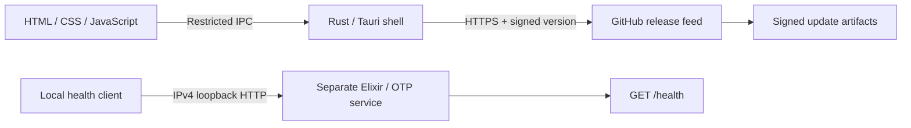

# Tailscale Commander Elite

**A Elite Estrangeira · Rust / Tauri 2 · Elixir / OTP · Signed software delivery**

A security-oriented desktop application foundation built with the operating system's WebView, a Rust native shell, an independent lightweight Elixir/OTP service and cryptographically signed updates. Development prioritizes explicit trust boundaries, a small attack surface, reproducible verification and incremental engineering.

[Releases](https://github.com/kaua-silbershlach-parodes/tailscale-commander-elite/releases) · [Security audit](SECURITY_AUDIT.md) · [Development checklist](BOOK_CHECKLIST.md) · [Candidate CI](https://github.com/kaua-silbershlach-parodes/tailscale-commander-elite/actions/workflows/candidate.yml)

## Release status

| Channel | Version | State |
|---|---|---|
| Published stable | [v1.2.1](https://github.com/kaua-silbershlach-parodes/tailscale-commander-elite/releases/tag/v1.2.1) | Available |
| Integrated candidate | v1.2.3 | CP01–CP23; production signing and publication pending |
| Next integrated build | In preparation | CP01–CP23 source changes on main; compilation and assessment pending |

> **Development update — 28 November 2026.** The next integrated build is being prepared through a structured Rust engineering review. The changes below are included in the public source on `main` through checkpoint CP23. They are not yet published as an executable or validated by a new build. Historical CI results do not certify these changes. No release date or measured performance gain is claimed.

## Upcoming improvements

The current work strengthens verification of existing security and release controls rather than introducing unimplemented product features.

| Area | Source-level improvements prepared for the next build |
|---|---|
| Secure update transport | Regression helper rejects non-object configurations and malformed or unsafe transport flags; only absent or explicitly false dangerous flags are accepted. |
| Signed-update invariants | Existing signed-version requirement, downgrade prevention, pinned key and exact HTTPS update endpoint remain covered. |
| Content Security Policy | Exact nine-directive allowlist, accepting equivalent directive ordering and surrounding whitespace; rejects missing, duplicate, extra, weakened and empty policies. |
| Structured errors | Typed CSP violations distinguish unexpected, duplicate and missing directives. Rust `Result`, pattern matching and error propagation improve diagnostic precision. |
| Version integrity | Dedicated pure validator checks Tauri, Cargo and the current Mix manifest format; missing, invalid, incompatible and duplicate version declarations have negative fixtures. |
| Borrowing and allocation | Manifest version comparison borrows string slices instead of constructing an intermediate comparison string. |
| Linux iterator verification | Expanded GLib regression covers size hints, exact remaining length, repeated exhaustion, empty arrays, count, out-of-range skips and arithmetic overflow. Authenticated vendor source is unchanged. |
| Cargo distribution policy | Registry publication is disabled in the application manifest; repository and existing license-file metadata are explicit. |
| Rust API documentation | Crate scope, entry-point behavior and explicit-exit destructor limitations are documented, with a signature doctest that does not launch the application. |
| Ownership and lifetime verification | Linux regression covers borrowed strings surviving iterator scope, independent iterator cursors, explicit iterator drop, nonzero skips, empty strings and Unicode. No new shared mutable ownership or custom smart pointers. |
| Concurrency verification | Bounded concurrent mixed loopback TCP requests check response isolation and worker recovery; controlled-promise UI regressions cover in-flight refresh, stale approval invalidation and failure recovery. No new runtime threads or locks. |
| Updater lifecycle | Single tagged state replaces independent flags; pending approval is paired with its timestamp and consumed when installation starts. New regressions cover no-update recovery and exclusive in-flight installation. Runtime refactor awaits integrated tests. |
| Pattern-based updater policy tests (CP10) | Typed failures, exact boolean and single-endpoint slice matching, guarded pinned public-key checks and missing/malformed configuration fixtures. Test-only; not a new signature verifier. |
| Advanced Rust safeguards (CP11) | Package lint policy surfaces unsafe code for review and denies implicit unsafe operations inside unsafe functions. The Linux regression specifies a borrowed-string iterator trait contract checked by the compiler during the next build. Macro and vendor code unchanged; compiler validation pending. |
| TCP lifecycle and framing (CP12) | Split-write and abandoned-request regressions check complete header framing, response byte length, cache policy, socket closure, worker cleanup and listener recovery. Corrected a prior CRLF fixture. Existing runtime worker limits and routes are unchanged. |
| Development tool review (CP13) | Document first-party formatting and locked Clippy review before the next integrated build. Keep the existing Rust edition, compiler and derived diagnostic traits. No automatic fixes or tool installation. |
| Toolchain consistency (CP14) | Windows clone-and-check explicitly selects the pinned candidate compiler for locked type checking; documented Rust test commands use the same version. Source-only inspection remains separate from compiler work. Script validation pending. |
| Input parsing (CP15) | Expanded backend port-parser fixtures cover valid numeric boundaries, accepted formatting, malformed and oversized values, Unicode numerals and exact error payloads. Existing runtime parser unchanged. |
| Approval age validation (CP16) | Name the ten-minute approval limit and reject negative or non-finite elapsed time before installing. Deterministic regressions cover the exact boundary and clock anomalies. Wall-clock time remains in use; functional verification pending. |
| Borrowed policy diagnostics (CP17) | Add a regression for complete UTF-8 unexpected and duplicate CSP directives borrowed from their original policy buffer. No new allocation or unsafe operation in the validator; compilation pending. |
| Structured version fixtures (CP18) | Group the three borrowed version inputs in a private named-field struct with a read-only validation method. Existing checks and error categories are retained; compiler validation pending. |
| Typed capability checks (CP19) | Dedicated regression guard distinguishes window scope, exact permission set, remote declaration, window definition and installer-mode violations; 21 negative fixtures. Existing capability configuration unchanged; effective runtime ACL evaluation and compilation pending. |
| Private test module (CP20) | Extract the 13 security regression tests into `src-tauri/src/security_tests.rs`, retaining test-only visibility, fixture paths and test bodies. The native entry point and exact Linux regression selector remain in the crate root. Source equivalence verified; compiler validation pending. |
| Collection and encoding checks (CP21) | Add 15 backend header fixtures covering case-insensitive keys, duplicate rejection before map overwrite, accepted formatting and invalid ASCII/UTF-8 fields. Existing runtime parser and byte limit unchanged; functional verification pending. |
| Recoverable restart errors (CP22) | Restrict relaunch to the post-installation state, exclude concurrent restart requests and permit explicit retry on a returned or failed relaunch. Three deterministic regressions cover the state contract; native restart verification pending. |
| Generic fixture helper (CP23) | Share the negative JSON mutation procedure across typed updater and capability errors, preserving 32 field cases and the distinction between absent fields and explicit null values. Compiler validation pending. |
| Test design | Independent positive and negative fixtures, per-directive omission checks, exact failure categories, diagnostic assertions and preservation of the existing CI regression selector. No newly ignored security tests. |

These changes strengthen **test coverage, diagnostics, documentation, distribution safeguards and existing updater state management**, not new runtime network or access enforcement mechanisms. The current source changes introduce no additional Rust dependencies, public APIs, interface panels, network permissions or version changes.

### Technical review progress

All twenty chapters, front matter, five appendices and the index of the private Rust reference have been reviewed through extracted text: 559 of 559 physical pages accounted for through CP23 (100% physical-page coverage), including seventeen pages without extracted text. Visual inspection and integrated implementation validation remain pending. Topics include automated tests, modularity, recoverable errors, references, functional abstractions, iterators, closures, Cargo release engineering, ownership, smart pointers, safe concurrency, state-oriented design, pattern matching, advanced Rust safeguards and bounded server lifecycle. CP01–CP23 are published source. Integrated compilation and functional validation remain pending. The study is targeted rather than sequential from page one. Checkpoints record reading coverage separately from implementation validation. Private reference titles, library paths and local backups are not published.

| Integration gate | Status |
|---|---|
| Incremental source review and edits | In progress |
| Git whitespace/diff checks | Passed for completed checkpoints |
| Integrated compilation and full Rust tests | Pending |
| Windows/Linux candidate build and smoke assessment for new changes | Pending |
| Production signing and isolated installation verification | Pending |
| New public release | Not published |

## Architecture and current scope



The desktop UI includes Updates and Backend panels. Updates displays the installed version, asks for approval, shows update progress and supports restart. The Backend panel is informational; it does not query, launch, authenticate or supervise the separate backend. The OTP application supervises its own TCP listener. The frontend needs no npm packages or bundler.

This is a desktop foundation, **not a functioning Tailscale VPN client, remote-control service or complete enterprise Zero Trust platform**. VPN management, remote sessions, user authentication and device enrollment are not implemented.

| Layer | Location | Responsibility |
|---|---|---|
| Desktop UI | `ui/` | Version display and update interface |
| Native shell | `src-tauri/src/` | Lifecycle, logging, updater and restart |
| Policy configuration | `src-tauri/tauri.conf.json`, `src-tauri/capabilities/` | CSP, prototype freezing, IPC permissions and pinned update key |
| OTP backend | `backend/` | Independent loopback health endpoint |
| Security and release tools | `tests/`, `tools/`, `scripts/` | Regression tests, verification and authorized installation |
| CI | `.github/workflows/` | Candidate validation, scheduled audit and gated release |
| Linux compatibility | `src-tauri/vendor/glib-0.18.5/` | Authenticated upstream iterator backport |

## Security baseline

The integrated candidate already defines the following controls. Their historical verification is separate from the new work above.

- **Backend:** default deny; only valid `GET /health` succeeds. Malformed requests return 400, unsupported routes/methods 404, oversized requests 413 and read timeouts 408. IPv4 loopback, Host validation, duplicate-header rejection, no request body or transfer encoding, 8,192-byte request cap, five-second read deadline and 32 concurrent workers. Health data is unauthenticated and does not prove service identity.
- **Desktop:** restrictive CSP, prototype freezing and an explicit main-window capability allowlist. No arbitrary shell-execution capability.
- **Updates:** HTTPS, pinned public key, signatures, signed-version enforcement, downgrade rejection, stale approval revalidation after ten minutes and prevention of concurrent installations.
- **Independent verifier:** checks the three published platform artifacts and both feed signatures, signed version/file metadata, expected URLs, SHA-256, sizes and duplicate JSON keys; never executes downloaded release artifacts.
- **Supply chain:** commit-pinned Actions, read-only workflow permissions, locked dependencies, authenticated verifier provisioning and integrity checks over the GLib backport.

See [SECURITY_AUDIT.md](SECURITY_AUDIT.md) for trust boundaries, risks and release gates.

## Platforms and toolchain

| Component | Candidate configuration |
|---|---|
| Windows | x86-64, MSVC, WebView2, per-user NSIS installer |
| Linux | x86-64, Ubuntu 22.04 CI, GTK3/WebKitGTK 4.1, AppImage and deb targets |
| Rust | 1.100.0; locked dependencies |
| Tauri | 2.12.7; CLI 2.12.6; updater 2.14.1 |
| Elixir / OTP | CI Elixir 1.17 / OTP 27; project requires Elixir ~> 1.14 |
| Windows bootstrap | Script 01: OTP 29.1.2 and Elixir 1.20.5 |
| Verification | Node.js, Python 3, cryptography and trusted minisign 0.12 |

These are configured or historically validated candidate environments, not blanket platform certification. macOS and mobile are not validated release targets.

## Obtain the source

Use an isolated development checkout; do not install an unsigned review build over production.

```sh
git clone https://github.com/kaua-silbershlach-parodes/tailscale-commander-elite.git
cd tailscale-commander-elite
```

The public source on `main` includes checkpoints CP01–CP23. These source changes are not a validated binary release. Use [Releases](https://github.com/kaua-silbershlach-parodes/tailscale-commander-elite/releases) for published downloads.

### Development build (when authorized)

Source-only review does not invoke Cargo compilation commands. `cargo check` avoids producing the final executable but still performs compiler work and can build dependencies and run build scripts. Defer it, tests, Clippy and installer scripts until integrated validation is authorized. Keep the existing toolchain pin and lockfile; verify the configured toolchain before any installer run.

```sh
rustup toolchain install 1.100.0 --profile minimal
cd src-tauri
cargo +1.100.0 test --locked
cargo +1.100.0 build --release --locked
```

Windows requires Visual Studio C++ build tools and WebView2. Ubuntu requires `libwebkit2gtk-4.1-dev`, `libgtk-3-dev`, `libsoup-3.0-dev`, `librsvg2-dev`, `libayatana-appindicator3-dev`, `patchelf` and `file`. The build creates an unsigned development executable, not signed release bundles.

### Run the separate backend

```sh
cd backend
mix run --no-halt
```

From another terminal: `curl http://127.0.0.1:45900/health`.

Expected candidate response:

```json
{"status":"ok","service":"tailscale_commander_elite_backend","version":"1.2.3"}
```

`TAILSCALE_COMMANDER_ELITE_BACKEND_PORT` overrides the default port 45900; 0 selects an ephemeral test port. See [backend documentation](backend/README.md).

## Verification and release engineering

When the integrated build is authorized, run the full applicable regression suite. Focused tests help diagnose failures but do not replace the complete suite.

```sh
node --test tests/test_ui.cjs
python -m unittest discover -s tools -p 'test_*.py'
python tools/verify_glib_vendor.py
python tools/dependency_scope.py
python tools/dependency_policy.py
python tools/verify_release.py latest
```

Run backend tests from `backend/` with an ephemeral port (`TAILSCALE_COMMANDER_ELITE_BACKEND_PORT=0 mix test` in POSIX shells; in PowerShell set `$env:TAILSCALE_COMMANDER_ELITE_BACKEND_PORT='0'` before `mix test`). Run `cargo +1.100.0 test --locked` from `src-tauri/`. Before the next authorized integrated validation, review first-party formatting and static-analysis diagnostics with the pinned toolchain. These commands are planned, not completed checks:

```sh
# From src-tauri/, after rustfmt and Clippy are available for the pinned toolchain
cargo +1.100.0 fmt --check
cargo +1.100.0 clippy --locked --all-targets
```

Clippy invokes compiler analysis and may compile dependencies; defer it until build authorization. Review each diagnostic and any formatting diff before applying changes. Do not use automatic fixes or edition migration as a substitute for review; preserve the authenticated vendor tree. On Linux also execute:

```sh
cargo +1.100.0 test --release --locked glib_variant_string_iterator_backport_regression -- --exact
```

Confirm that the named regression actually ran. Python signature tests require cryptography and trusted minisign on PATH. Use the authenticated platform bootstrap scripts in `tools/` before running a newly obtained verifier. The latest-release command verifies the published release, not the local candidate.

### Historical evidence and dependency risk

Prior integrated-candidate evidence is documented in [SECURITY_AUDIT.md](SECURITY_AUDIT.md), including Windows/Linux builds, Rust/Elixir/UI regressions, verifier tests and hosted ephemeral-key installer smoke tests. See historical [CI run 45888806546](https://github.com/kaua-silbershlach-parodes/tailscale-commander-elite/actions/runs/45888806546) and the [candidate workflow](https://github.com/kaua-silbershlach-parodes/tailscale-commander-elite/actions/workflows/candidate.yml). Results apply only to their respective commits.

| Advisory | Baseline disposition |
|---|---|
| RUSTSEC-2026-0594 | cookie updated to 0.18.3 |
| RUSTSEC-2024-0429 | GLib 0.18.5 authenticated local backport; [upstream PR 1343](https://github.com/gtk-rs/gtk-rs-core/pull/1343) |
| RUSTSEC-2026-0543 | chrono optional metadata/lockfile entry; absent from reviewed Windows/Linux build trees |
| RUSTSEC-2024-0370 | proc-macro-error Linux build-time dependency |

The unfiltered strict audit remains visible. Only the two exact maintenance warnings accepted in the risk policy are temporarily permitted, until 27 December 2026 UTC (exclusive). Any vulnerability, other warning, scan failure, expiry or scope drift blocks the applicable release gate. No scanner ignore flags are used. The GLib registry version remains 0.18.5; the local backport is not an upstream published fix.

### Authorized Windows release workflow

| Script | Purpose |
|---|---|
| `01-install-prerequisites.ps1` | Provision missing platform/toolchain prerequisites |
| `02-clone-and-check.ps1` | Clean checkout and validation |
| `03-build-installer.ps1` | Authorized signing and installer verification |
| `04-install-app.ps1` | Verify and install approved per-user artifact |
| `05-run-smoke-tests.ps1` | Verify version, launch and backend liveness |

Release signing requires recorded approval, completed pre-signing assessment and a passing dependency policy. Version tags trigger the gated release build. The full candidate workflow, including both platform regression suites, disposable-key package smoke tests, signature verification and dependency checks, must pass on the tagged tree before either production signing job starts. Publishing verified signed bundles and the update feed remains separate. Candidate CI uses disposable signing material for isolated smoke tests, not production keys. Full clean Windows bootstrap/rollback, independent semantic reread of the first reference and production signed v1.2.2 bundles with isolated installation verification remain open. Never commit signing keys, passwords, access tokens or private review artifacts.

## Roadmap

1. Continue technical review and record applicable improvements to existing code.
2. Integrate reviewed changes, run the native test suites and build Windows/Linux candidates.
3. Resolve any failures, rerun applicable security gates and complete the independent assessment.
4. After authorization, sign and verify production artifacts, perform isolated installation checks and publish the release.

There is no announced release date. The upcoming build is preparation work, not an available download. See [BOOK_CHECKLIST.md](BOOK_CHECKLIST.md) for the audit trail and source-review checkpoints; build, functional tests and independent assessment remain pending.

## License

Copyright 2026 A Elite Estrangeira. All rights reserved for first-party code; see [LICENSE](LICENSE). Third-party GLib retains its original [license](src-tauri/vendor/glib-0.18.5/LICENSE) and [copyright notices](src-tauri/vendor/glib-0.18.5/COPYRIGHT).
