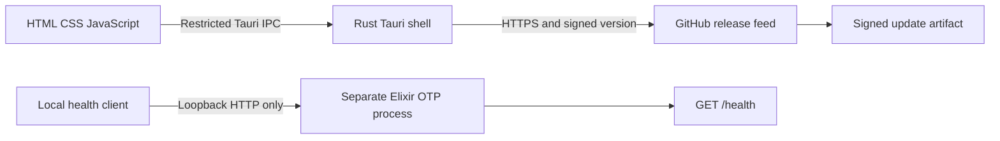

# Tailscale Commander Elite

Desktop application foundation by A Elite Estrangeira. Built with Rust, Tauri 2, the operating system WebView, a dependency-free Elixir/OTP backend, and cryptographically signed updates.

| Channel | Version | Status |
|---|---|---|
| Published stable | [v1.2.2](https://github.com/kaua-silbershlach-parodes/tailscale-commander-elite/releases/tag/v1.2.2) | Published and verified |
| MCP connectivity review | v1.2.3 | Development candidate; live connector and production signing pending |

**Scope:** This is the desktop foundation, not a functioning Tailscale network client, remote-control service, or complete enterprise Zero Trust architecture. No remote sessions, user authentication, VPN management or device enrollment are implemented by this version.

## Architecture



The Windows candidate has four panels: OpenAI Secure MCP Tunnel, Updates, Backend, and Tailscale connection. The Backend panel is informational; it does not query, launch, authenticate or supervise the separate backend. The OTP application supervises its own TCP listener. The frontend uses no npm packages or bundler.

| Component | Location | Responsibility |
|---|---|---|
| Desktop UI | `ui/` | Version display, update approval, progress and restart |
| Rust shell | `src-tauri/src/` | Tauri lifecycle, updater, logging, restart |
| Security configuration | `src-tauri/tauri.conf.json`, `capabilities/` | CSP, prototype freezing, IPC permissions and pinned updater key |
| Backend | `backend/` | Independent OTP health endpoint |
| Build and installation | `scripts/` | Windows prerequisites, checkout, packaging, installation and smoke checks |
| Security tooling | `tools/` | Signature verification, authenticated verifier provisioning, vendor integrity and dependency scope |
| Regression tests | `backend/test/`, `src-tauri/src/lib.rs`, `tests/`, `tools/test_*.py` | Native TCP, shell configuration, UI and security tooling |
| Workflows | `.github/workflows/` | Candidate CI, scheduled audit, gated release |
| Third-party backport | `src-tauri/vendor/glib-0.18.5/` | Authenticated GLib source with upstream iterator correction |

## Supported platforms and toolchain

| Item | Candidate configuration |
|---|---|
| Windows | x86-64; MSVC, WebView2; per-user NSIS installer |
| Linux | x86-64; Ubuntu 22.04 CI, GTK3/WebKitGTK 4.1; AppImage and deb packaging targets |
| Rust | 1.100.0, locked dependencies |
| Tauri | 2.12.7; CLI 2.12.6; updater 2.14.1 |
| BEAM | CI Elixir 1.17 / OTP 27; project requires Elixir ~> 1.14 |
| Windows bootstrap | OTP 29.1.2 and Elixir 1.20.5 in script 01 |
| Test tools | Node.js (built-in test runner), Python 3 and cryptography, trusted minisign 0.12 |

These are validated candidate configurations or explicitly configured packaging targets, not a guarantee of support on every distribution or operating system. macOS and mobile are not validated release targets.

## Obtain and build the candidate

Use an isolated checkout for development. Do not install a review build over a production installation. A trusted Git client, Rust toolchain and platform build dependencies are required.

```sh
git clone --branch review/mcp-v1.2.3 https://github.com/kaua-silbershlach-parodes/tailscale-commander-elite.git
cd tailscale-commander-elite
rustup toolchain install 1.100.0 --profile minimal
cd src-tauri
cargo +1.100.0 test --locked
cargo +1.100.0 build --release --locked
```

On Windows, use a Visual Studio C++ build environment and WebView2. On Ubuntu, install the system dependencies listed in `candidate.yml`: `libwebkit2gtk-4.1-dev`, `libgtk-3-dev`, `libsoup-3.0-dev`, `librsvg2-dev`, `libayatana-appindicator3-dev`, `patchelf` and `file`.

The build command creates an unsigned development executable. It does not generate, sign, publish or install release bundles. The release workflow is a separate gated process.

### Run the backend

```sh
cd backend
mix run --no-halt
```

In another terminal: `curl http://127.0.0.1:45900/health`

Expected candidate response:

```json
{"status":"ok","service":"tailscale_commander_elite_backend","version":"1.2.2"}
```

`TAILSCALE_COMMANDER_ELITE_BACKEND_PORT` changes the listener port; `0` requests an ephemeral port for tests. With no override the port is 45900. The listener binds IPv4 loopback only. See [backend documentation](backend/README.md).

## Security controls

- Default-deny request handling: only a valid `GET /health` succeeds. Malformed requests return 400, unsupported routes/methods 404, oversized requests 413 and read timeouts 408.
- Loopback binding, Host validation, duplicate-header rejection, no request body or transfer encoding, 8,192-byte request limit, 5-second read deadline, 32 concurrent workers, bounded accept and socket handoff. Health data is non-confidential but unauthenticated; never treat it as proof of service identity.
- Restrictive content security policy, prototype freezing and an explicit window capability allowlist. No arbitrary shell-execution capability is exposed.
- Updates use HTTPS and a pinned public key; signed-version enforcement and downgrade prevention are enabled. Stale approval (over ten minutes) requires a new check and user action. Concurrent installation attempts are blocked.
- The independent verifier checks the three published platform artifacts and both feed signatures, signed version/file metadata, expected release URLs, SHA-256, size and duplicate JSON keys. It never executes release artifacts.
- GitHub Actions are pinned by commit, use read-only permissions and require strict dependency auditing. Production signing keys are not used by candidate CI.
- Linux GLib uses the exact registry archive with the two-line upstream correction; CI checks all 121 vendor files and runs a targeted optimized regression.

## Tests and verification

From the repository root:

```sh
node --test tests/test_ui.cjs
python -m unittest discover -s tools -p 'test_*.py'
python tools/verify_glib_vendor.py
python tools/dependency_scope.py
python tools/verify_release.py latest
```

Python signature tests require cryptography and a trusted minisign on PATH. The latest-release command verifies the currently published stable release, not the unsigned candidate. On Linux x86-64, `python tools/bootstrap_minisign.py --bin-dir /path/to/new/private/bin` authenticates the official 0.12 binary before installation; add that directory to PATH for the verification session. On Windows, run python tools/bootstrap_minisign_windows.py --bin-dir with a new private output directory; it checks the previously authenticated archive and executable SHA-256 pins before executing the verifier, then checks the upstream signature. Never run an unverified verifier executable.

Backend tests use an ephemeral port: on PowerShell set `$env:TAILSCALE_COMMANDER_ELITE_BACKEND_PORT='0'`; on POSIX shells use `TAILSCALE_COMMANDER_ELITE_BACKEND_PORT=0 mix test` from `backend/`. Run `cargo test --locked` from `src-tauri/`; on Linux additionally run `cargo test --release --locked glib_variant_string_iterator_backport_regression -- --exact` and verify the named test actually ran.

### Verified evidence

Historical evidence at commit [`37f6dff`](https://github.com/kaua-silbershlach-parodes/tailscale-commander-elite/commit/37f6dff8035eec0e227e0fb1143affe1cf572ab4), [CI run 45888806546](https://github.com/kaua-silbershlach-parodes/tailscale-commander-elite/actions/runs/45888806546):

| Check | Result |
|---|---|
| Windows and Linux native tests and optimized executable builds | Passed |
| Rust configuration regression tests | 4 Windows; 5 Linux passed |
| Native Elixir TCP tests | 8 passed per platform |
| UI updater regression tests | 7 passed per platform |
| Verifier bootstrap and signature tests | 6 + 7 passed |
| Exact GLib backport and optimized Linux test | Passed |
| Strict Cargo Audit | Failed on 2 maintenance warnings |
| Candidate signed bundles and installation smoke test | Hosted Windows ephemeral-key test added; result pending |

These results apply to the cited commit, not automatically to later changes. Review the [current candidate CI](https://github.com/kaua-silbershlach-parodes/tailscale-commander-elite/actions/workflows/candidate.yml) for the latest evidence.

## Dependency risk and release status

| Advisory | Disposition |
|---|---|
| RUSTSEC-2026-0594 (cookie) | Updated to 0.18.3; prior advisory absent on rescan |
| RUSTSEC-2024-0429 (GLib) | Local backport of [upstream PR 1343](https://github.com/gtk-rs/gtk-rs-core/pull/1343); integrity and optimized Linux regression passed |
| RUSTSEC-2026-0543 (chrono) | Optional metadata/lockfile entry; absent from current Windows and Linux build trees; no fixed published upgrade |
| RUSTSEC-2024-0370 (proc-macro-error) | Linux build-time procedural macro dependency; no fixed published upgrade |

The unfiltered `cargo audit --json --deny warnings` report remains visible. On 2026-11-27 the owner accepted only the two exact maintenance warnings above, until 2026-12-27 UTC (exclusive). The policy gate verifies the report, exact IDs and versions, expiry and target scope; any vulnerability, other warning, scan failure or scope drift blocks the build. No scanner ignore flags are used. Run `python tools/dependency_policy.py` with cargo-audit 0.23.0 installed. See [SECURITY_AUDIT.md](SECURITY_AUDIT.md). The upstream GLib version remains 0.18.5; its absence from a registry-oriented scanner report is not an upstream fix.

## Windows installation and release operations

The numbered scripts are for an explicitly authorized installation or release environment, not an automatic action for review builds:

| Script | Purpose |
|---|---|
| `01-install-prerequisites.ps1` | Provisions missing WinGet, Python and platform/toolchain prerequisites; uses hash-pinned official Windows x64 Tauri CLI |
| `02-clone-and-check.ps1` | Checks out the configured repository, rejects dirty existing clones and validates build/backend |
| `03-build-installer.ps1` | Requires recorded release approval, clean checkout, dependency risk policy and an existing restricted matching signing key; verifies the signed installer |
| `04-install-app.ps1` | Requires recorded release approval and checks the exact installer and signature before per-user installation |
| `05-run-smoke-tests.ps1` | Verifies installed version, exact published release version, launch and unauthenticated local backend liveness |

Clean Windows Sandbox testing confirmed installation of WinGet, Git, Python, Visual Studio Build Tools, WebView2 and Rust. Full clean-machine bootstrap and rollback remain unverified. The official pinned Tauri CLI binary was verified on an existing Windows host. Python and trusted minisign must be available before scripts 03–05. Script 05 pre-release mode is explicitly not release approval. The separate backend must be started before its health check. Never print or commit private signing keys, passwords or access tokens.

Release CI and the local signing script require recorded approval, a completed pre-signing assessment and a passing dependency risk policy before signing. Book 1 closes only after signed-release and isolated installation verification; the separate assessment avoids a circular release gate. The preflight rejects duplicate/conflicting approval markers and inconsistent versions. Local installation requires the recorded approval as well. It builds platform bundles on version tags; publishing a GitHub release and `latest.json` is a separate operation. A candidate push does not create a new release. Candidate CI includes a separate Windows hosted-runner-only NSIS signing, signature verification, installation, launch and uninstall smoke test with a newly generated throwaway key. It does not access production signing material, upload test installers, install on an operator machine or prove a production release is signed. The exact published version still requires independent verification.

## Audit and development policy

Book 1 remains open. Its applicable controls, risk register, historical evidence and authorization gate are documented in [SECURITY_AUDIT.md](SECURITY_AUDIT.md). The book-by-book sequence is tracked in [BOOK_CHECKLIST.md](BOOK_CHECKLIST.md). Every material change requires renewed inventory, relevant source review and applicable tests. No later book is claimed complete.

## License

First-party code: Copyright 2026 A Elite Estrangeira. All rights reserved; see [LICENSE](LICENSE). Third-party GLib source retains its original [license](src-tauri/vendor/glib-0.18.5/LICENSE) and [copyright notices](src-tauri/vendor/glib-0.18.5/COPYRIGHT).

## Experimental connectivity checkpoint

See [CONNECTIVITY_CHECKPOINT.md](CONNECTIVITY_CHECKPOINT.md) for the local feature branch scope, protected configuration, source tool mapping, and verification gates. The experimental changes are not a production release.

## Secure MCP Tunnel (v1.2.3 development candidate)

The public stable version is v1.2.2. The v1.2.3 candidate restores the Windows connectivity panel. Configure Tunnel ID and the OpenAI runtime API key locally, save in Windows Credential Manager, and explicitly connect. Only two read-only tools are available: system_info and tailscale_status. End-to-end ChatGPT connector validation is pending. Do not copy actual credentials into source or GitHub. For a source build on Windows, run python tools/bootstrap_tunnel_windows.py --bundle --bin-dir src-tauri/tunnel-runtime before Cargo; signed Windows bundles include the pinned client and its upstream notices. Linux connectivity is not implemented.
